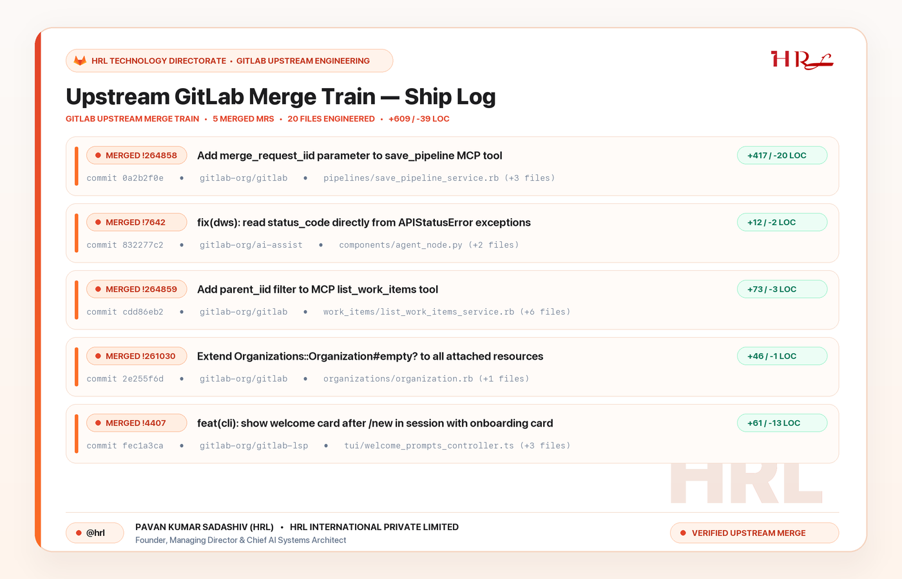
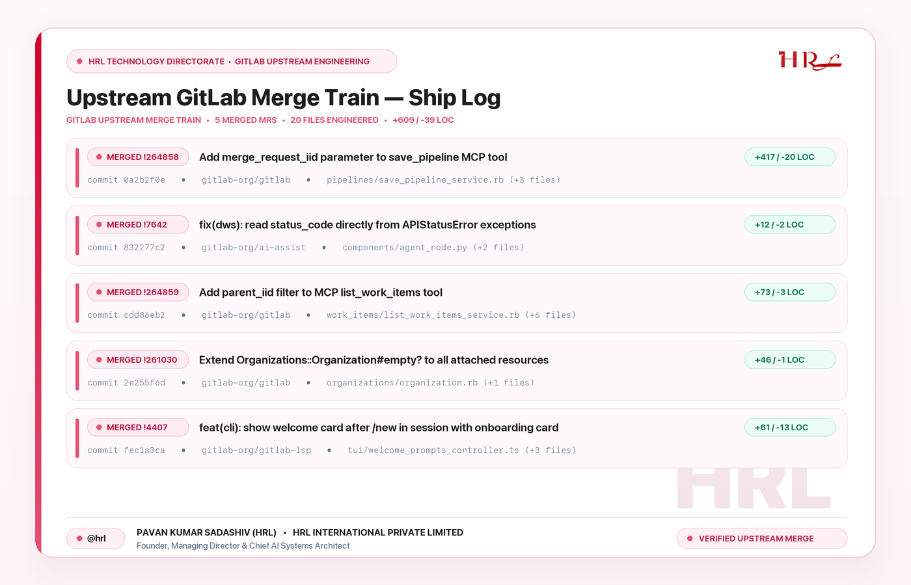

# HRL × LinkedIn Post Image (`HRL-X-Linkedin-Post-Image`)

Official **Apple-Grade Light-Theme Post Image Design System & LinkedIn Official REST API MCP Server** for **HRL International Private Limited** (`@hrl`).

---

## 1. Visual Preview — GitLab Tanuki Orange Theme (Default for GitLab Posts)



### HRL Signature Rose-Crimson Theme Variant (`--theme hrl-rose`)



---

## 2. Core Design Language Specification (`HRL-APPLE-LIGHT-V2`)

Every LinkedIn post image generated for **HRL International Private Limited** adheres to these non-negotiable rules:

### A. Light-Mode Only & 2x Retina Supersampling
- **Always Light Theme:** Warm Apple Alabaster studio backdrop (`#FCF9F8 → #FFF4EC` for GitLab Orange; `#FDF9FB → #FFF4F7` for HRL Rose) with a pure crisp white (`#FFFFFF`) main card shell (`28px` continuous squircle radius).
- **2x Retina Rendering Pipeline:** Rendered at `2800 × 1800 px` and downsampled via `LANCZOS` to `1400 × 900 px` so curves, hairlines, vector badges, and typography have zero aliasing.

### B. Context-Aware Brand Color Palettes
| Token | `gitlab-orange` (GitLab Posts) | `hrl-rose` (General HRL Posts) | Role |
| :--- | :--- | :--- | :--- |
| **Left Tactile Accent Bar** | `#E24329 → #FC6D26` | `#D1002D → #E05375` | `9px` vertical gradient boundary stripe masked to left card edge |
| **Header Category Pill** | `#FFF3EB` fill / `#FDCDb2` border | `#FFF0F4` fill / `#F5C6D3` border | Top-left category pill with GitLab Tanuki geometric emblem |
| **Row Surface & Border** | `#FFFBF8` fill / `#F6DED0` border | `#FFF9FB` fill / `#F7DAE3` border | Apple Bento-style row cards with inset `5px` accent indicator |
| **MR Badge Pill** | `#FFEE2` fill / `#C2341C` text | `#FFECF2` fill / `#B91C44` text | High-contrast merged MR identifier pill |
| **Diff Metric Pill** | `#ECFDF5` fill / `#047857` text | `#ECFDF5` fill / `#047857` text | Right-aligned `+add / -rem LOC` emerald indicator |
| **Watermark Monogram** | `rgba(226, 67, 41, 0.045)` | `rgba(224, 83, 117, 0.045)` | Translucent `"HRL"` watermark positioned cleanly above footer divider |

### C. Apple Cupertino Typography (`SF Pro` & `SF Mono`)
- **Primary Display & UI Font:** `/System/Library/Fonts/SFNS.ttf` (Apple San Francisco variable font using exact `Weight` & `Optical Size` axes: `800` Hero Title, `700` Pills/Badges, `650` Row Titles, `500` Subtitles).
- **Code & Commit Metadata Font:** `/System/Library/Fonts/SFNSMono.ttf` (`SF Mono`) formatted as `commit <sha> • <repo> • <short_path> (+N files)` so paths are never awkwardly truncated mid-word.

### D. Strict Executive Footer Standard (No Raw URLs)
- **Zero Raw URLs in Footer:** Never print raw website URLs in the bottom footer.
- **Footer Structure:**
  - Left: `● @hrl` tactile pill + **`PAVAN KUMAR SADASHIV (HRL) • HRL INTERNATIONAL PRIVATE LIMITED`** + `Founder, Managing Director & Chief AI Systems Architect`
  - Right: `● VERIFIED UPSTREAM MERGE` status badge

---

## 3. Quick Start & CLI Usage

### Render a GitLab Orange Ship Log Image (Default)
```bash
python3 hrl_post_image_generator.py \
  --theme gitlab-orange \
  --headline "Upstream GitLab Merge Train — Ship Log" \
  --output samples/hrl_gitlab_ship_log_apple_orange.png
```

### Render an HRL Rose-Crimson Image
```bash
python3 hrl_post_image_generator.py \
  --theme hrl-rose \
  --headline "HRL Engineering Release — Ship Log" \
  --output samples/hrl_ship_log_apple_rose.png
```

### Use from Python in Any Project
```python
from hrl_post_image_generator import render_hrl_post_image

render_hrl_post_image(
    mrs_data=[
        {
            "iid_str": "!264858",
            "title": "Add merge_request_iid parameter to save_pipeline MCP tool",
            "sha": "0a2b2f0e",
            "repo": "gitlab-org/gitlab",
            "primary_file": "app/services/mcp/tools/pipelines/save_pipeline_service.rb",
            "files_count": 4,
            "add": 417,
            "rem": 20,
        }
    ],
    headline="Upstream GitLab Merge Train — Ship Log",
    out_path="output.png",
    theme_name="gitlab-orange",
)
```

---

## 4. Antigravity LinkedIn Official REST API MCP Server (`linkedin_mcp_server.py`)

Included in this repository is [`linkedin_mcp_server.py`](./linkedin_mcp_server.py), a zero-dependency Python MCP server that connects Google Antigravity IDE directly to LinkedIn's Official REST API (`/rest/posts` & `/rest/images`):

- `linkedin_configure_credentials`: Interactive OAuth 2.0 callback listener (`http://localhost:8765/callback`) or token setup.
- `linkedin_get_profile`: Verifies member identity and resolves `urn:li:person:...`.
- `linkedin_create_post`: Publishes text, article preview cards, or uploaded images (`PUBLIC` / `CONNECTIONS` / `DRAFT`) with automatic LinkedIn Little Text Format escaping and `@[HRL International Private Limited](urn:li:organization:143684970)` collaboration tagging.
- `linkedin_edit_post`: Alters/updates published posts in-place via `X-RestLi-Method: PARTIAL_UPDATE`.
- `linkedin_delete_post`: Deletes posts by URN, URL, or `"latest"`.
- `linkedin_list_posts`: Lists tracked post URNs and live URLs.
- `linkedin_publish_ship_log`: Fetches live merged GitLab MRs, renders the 2x Retina HRL × GitLab Orange card via `hrl_post_image_generator.py`, uploads it to LinkedIn, and publishes the Ship Log post.
